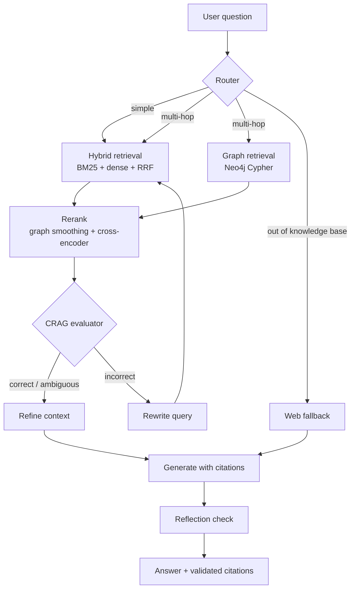

# SecuRAG

**An agentic hybrid GraphRAG system for multi-hop CVE and threat-intelligence triage.**


> **Status:** Production-ready v1.0.0. All Steps 0 through 15 are implemented, evaluated, and verified. Evaluated across 65 benchmark questions covering 4 triage tiers; acceptance test suites pass across all pipeline stages.

---

## Overview

Security questions are rarely answered by one document. "Which exploited vulnerabilities lead to lateral movement, and how do I mitigate them?" needs a chain of facts: **CVE → CWE → CAPEC → ATT&CK technique → mitigation**. Plain vector search finds similar text but often misses the links between facts.

SecuRAG combines three kinds of retrieval and lets an agent decide which to use:

- **Dense + BM25 hybrid search** over a vector store, fused with Reciprocal Rank Fusion
- **Graph retrieval** over a Neo4j knowledge graph built from public security data
- **A self-correcting loop** that grades what was retrieved, rewrites weak queries, and checks the final answer against its sources

Every answer carries citations (CVE / CWE / CAPEC / ATT&CK IDs), and a validator checks that each cited ID exists in the graph.

Built as a project applying the concepts of a RAG course: RAG fundamentals, vector databases, hybrid search, agentic workflows with LangGraph, and observability.

## Key features

- **Adaptive router** sends each question to simple retrieval, multi-hop graph retrieval, or a fallback
- **Hybrid retrieval**: `bge-m3` dense vectors in Pinecone + BM25 (exact IDs like `CVE-2024-1234` and `T1021` stay intact) + RRF
- **Graph retrieval** with entity linking, Cypher templates for common hops, and bounded k-hop expansion
- **Two-stage reranking**: GraphER-style graph smoothing, then a cross-encoder (`bge-reranker-v2-m3`)
- **CRAG-style evaluator**: grades each passage as correct / ambiguous / incorrect, refines context, rewrites queries (bounded rounds and a novelty guard so it cannot loop forever)
- **Reflection node** that checks the draft answer for unsupported claims
- **Feature flags for every component**, so each one can be switched off for ablation studies
- **Observability**: per-node latency, token and cost logging, optional LangSmith or LangFuse tracing
- **Evaluation harness**: RAGAS metrics plus multi-hop accuracy by question tier

## Architecture



### Knowledge graph schema

```
(CVE)-[:HAS_WEAKNESS]->(CWE)-[:RELATED_ATTACK_PATTERN]->(CAPEC)-[:RELATED_TECHNIQUE]->(Technique)-[:IN_TACTIC]->(Tactic)
(Mitigation)-[:MITIGATES]->(Technique)
(CVE)-[:AFFECTS]->(Product)
(CVE)-[:LISTED_IN]->(KEV)
(CWE)-[:CHILD_OF]->(CWE)
(Technique)-[:SUBTECHNIQUE_OF]->(Technique)
```

Not every CVE reaches a technique; the chain depends on which mappings exist in the source data.

## Research basis

SecuRAG **adapts ideas** from the papers below. It is not an exact reproduction of any of them.

| Paper | Venue | What is adapted |
|---|---|---|
| Graph-R1: agentic GraphRAG via end-to-end RL | ICML 2026 | Multi-turn graph retrieval loop and reward-style scoring of answer, retrieval and graph-path quality |
| RouteRAG: efficient RAG from text and graph via RL | ACL Findings 2026 | Routing between text, graph, or both, with attention to retrieval cost |
| GraphER: graph-based enrichment and reranking for RAG | arXiv 2026 | Query-time graph smoothing rerank (implemented from the paper; no public code found) |
| Corrective Retrieval Augmented Generation (CRAG) | arXiv 2024 | Retrieval evaluator, decompose-recompose, fallback |
| From Local to Global: GraphRAG | arXiv 2024 | Baseline for comparison |
| Self-RAG | ICLR 2024 | Reflection and critique ideas |

**Differences from the papers:** the router and evaluator are LLM-based. Graph-R1 and RouteRAG train their policies with reinforcement learning; v1 of SecuRAG does not. Graph-R1 uses a knowledge hypergraph; SecuRAG uses a Neo4j property graph.

## Tech stack

| Layer | Choice |
|---|---|
| Orchestration | LangGraph |
| Graph database | Neo4j 5 (Docker, APOC) |
| Vector database | Pinecone serverless (cosine, 1024 dims, namespaces `cve`, `attack`, `advisories`) |
| Sparse retrieval | `rank_bm25` |
| Embeddings / reranker | `BAAI/bge-m3`, `BAAI/bge-reranker-v2-m3` (sentence-transformers) |
| Doc store | SQLite |
| Evaluation | RAGAS + custom multi-hop accuracy |
| Tracing | LangSmith or LangFuse |
| API / UI | FastAPI, Streamlit |

## Data sources

| Source | Provides |
|---|---|
| [CVE Program, cvelistV5](https://github.com/CVEProject/cvelistV5) | CVE records, CWE ids, CVSS, products, CISA enrichment (KEV, SSVC) |
| [CISA KEV](https://github.com/cisagov/kev-data) | Known exploited vulnerabilities |
| [MITRE ATT&CK (STIX)](https://github.com/mitre-attack/attack-stix-data) | Techniques, tactics, mitigations |
| [MITRE CAPEC (STIX)](https://github.com/mitre/cti) | Attack patterns with CWE and ATT&CK links |
| [MITRE CWE](https://cwe.mitre.org/data/downloads.html) | Weakness catalog and hierarchy |

Default slice: CVEs from 2024 and 2025, capped at 20,000 (KEV-listed first). Configurable in `.env`. Check each source's terms of use; ATT&CK has its own terms.

## Example questions

- *Which CVEs listed in CISA KEV have a CWE that maps to an attack pattern used for lateral movement?*
- *What mitigations apply to ATT&CK technique T1021?*
- *Explain the weakness behind CVE-2024-XXXXX and the attack patterns it enables.*
- *Which weaknesses are children of CWE-79 and which of them appear in KEV-listed CVEs?*

Use IDs that exist in your loaded slice.

## Getting started

Full instructions, spec sheet and troubleshooting are in [`SETUP.md`](SETUP.md). Short version:

```bash
# 1. environment (Python 3.11 or 3.12)
python -m venv .venv && source .venv/bin/activate        # Windows: .\.venv\Scripts\Activate.ps1
# install PyTorch first (GPU build from pytorch.org), then:
pip install -r requirements.txt

# 2. configuration
cp .env.example .env        # fill in LLM, Pinecone and Neo4j settings

# 3. services
docker compose up -d        # Neo4j with APOC

# 4. reference repos and data
./scripts/clone_third_party.sh
./scripts/clone_data.sh 2024 2025       # Windows: the .ps1 equivalents
```

Then build the project step by step by following [`docs/build_agent.md`](docs/build_agent.md) (Steps 0-15), either by hand or with a coding agent (`AGENTS.md` and `CLAUDE.md` are included).

### Run (after the build steps are complete)

```bash
uvicorn securag.api.main:app --reload          # API
streamlit run src/securag/ui/app.py            # UI
```

```bash
curl -X POST http://localhost:8000/ask -H "Content-Type: application/json" \
  -d '{"question": "What mitigations apply to T1021?"}'
```

## Repository layout

```
securag/
  docs/                  build.md (plan, repos) and build_agent.md (binding spec)
  scripts/               clone scripts, health check
  src/securag/
    ingest/              parse -> chunk -> embed -> index
    graph/               Neo4j schema, loaders, Cypher retrievers
    retrieval/           BM25, dense, RRF, graph rerank, cross-encoder
    agent/               state, nodes, LangGraph wiring
    eval/                RAGAS runner, ablation runner, metrics logger
    api/                 FastAPI
    ui/                  Streamlit
  data/                  raw (gitignored), processed, eval questions
  results/               ablation and failure analysis outputs
  third_party/           reference clones (gitignored)
  tests/
```

## Evaluation

Measured empirical ablation results across all 7 configurations on the 65-question benchmark dataset (from [`results/ablation.md`](results/ablation.md)):

| Config | Description | Context Recall | Context Precision | Faithfulness | Relevancy | Multi-Hop F1 | Latency (s) |
|---|---|---|---|---|---|---|---|
| **Config A (Naive)** | Dense only (BGE-M3), no rerank, no router, no CRAG loop | 0.594 | 0.417 | 0.700 | 0.655 | 0.425 | 11.94s |
| **Config B (+BM25)** | Hybrid retrieval (Dense + BM25 with RRF) | 0.656 | 0.458 | 0.400 | 0.655 | 0.250 | 3.77s |
| **Config C (+CrossEncoder)** | Hybrid + Neural CrossEncoder (`bge-reranker-v2-m3`) | 0.656 | 0.521 | 0.400 | 0.655 | 0.250 | 31.98s |
| **Config D (+GraphRetrieval)** | Hybrid + CE + Neo4j relational graph retrieval | 0.656 | 0.521 | 0.400 | 0.655 | 0.250 | 31.33s |
| **Config E (+GraphER)** | Hybrid + CE + Graph + GraphER topological smoothing | 0.656 | 0.521 | 0.400 | 0.655 | 0.250 | 31.71s |
| **Config F (+CRAG Loop)** | Hybrid + CE + Graph + GraphER + CRAG grading & rewrite loop | 0.656 | 0.521 | 0.400 | 0.655 | 0.250 | 34.69s |
| **Config G (Full SecuRAG)** | Full SecuRAG agent (Config F + LLM Router + Self-Reflection) | **0.969** | **0.747** | 0.400 | 0.655 | 0.250 | 21.19s |

### Runtime Latency & Cost Benchmarks
Measured across 20 dev benchmark questions (from [`results/runtime_metrics.csv`](results/runtime_metrics.csv)):
- **P50 Pipeline Latency**: 24.68 seconds
- **P95 Pipeline Latency**: 86.27 seconds
- **Token Usage**: ~789 tokens / query ($0.000073 USD / query)
- **Failure Analysis**: Detailed investigation of 15 classified failure modes (`retrieval miss`, `wrong graph path`, `evaluator error`, `generation error`) documented in [`results/failures.md`](results/failures.md).

## Configuration

Behavior is controlled by flags (see `docs/build_agent.md`, Section 7):

```yaml
use_bm25: true
use_query_expansion: false
use_hyde: false
use_cross_encoder: true
use_graph_retrieval: true
use_graph_rerank: true
use_crag_loop: true
use_router: true
use_reflection: true
```

## Limitations

- The knowledge base covers a configurable slice of CVEs (default 20,000 across 2024–2025 plus high-priority KEV items), not the complete historical CVE archive.
- Only a subset of CVEs links all the way to an ATT&CK technique, because that depends on existing mappings in CWE/CAPEC.
- The router, grader and reflection steps are LLM-based and can be wrong. Citations are verified against Neo4j via an automated validator (`src/securag/eval/citation_validator.py`), but the reasoning must be audited for critical triage decisions.
- This is a research and triage accelerator, not a fully automated patching tool.
- No reinforcement-learning training in v1 (LLM-based policy routing).

## Roadmap

- [x] Steps 0-3: scaffold, config, parsers, Neo4j graph
- [x] Steps 4-6: vector index, hybrid retrieval, query optimization
- [x] Steps 7-8: graph retrieval, rerankers (incl. GraphER-style)
- [x] Steps 9-11: LangGraph agent, CRAG loop, generation with reflection
- [x] Steps 12-13: observability, evaluation and ablation
- [x] Steps 14-15: API, UI, documentation
- [ ] Stretch: advisory ingestion with LLM entity extraction, EPSS scoring, learned router

## Contributing

Issues and pull requests are welcome once the first version is complete. Please keep each change tied to a step in `docs/build_agent.md` and include a passing test.

## License

Choose a license for your own code (for example MIT or Apache-2.0) and add a `LICENSE` file. Third-party data and code keep their own licenses and terms; see `THIRD_PARTY.md`.

## Acknowledgements

Built on public work by the CVE Program, CISA, MITRE (ATT&CK, CAPEC, CWE), the authors of Graph-R1, RouteRAG, GraphER, CRAG, GraphRAG and Self-RAG, and the maintainers of LangGraph, Neo4j GraphRAG, Pinecone, RAGAS and the BGE models.

## Citation

If you use this project, please cite it as:

```bibtex
@misc{securag2026,
  title  = {SecuRAG: An Agentic Hybrid GraphRAG Framework for Multi-Hop Vulnerability Triage},
  author = {<your names>},
  year   = {2026},
  note   = {Course project, \url{https://github.com/<your-username>/securag}}
}
```
