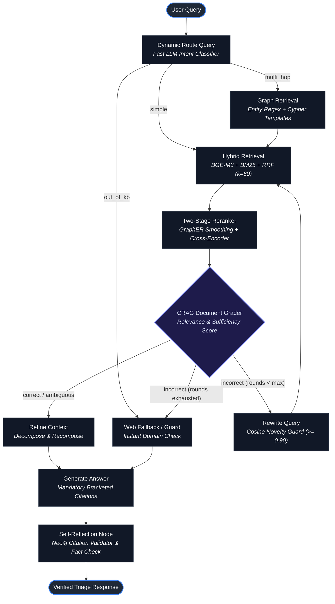
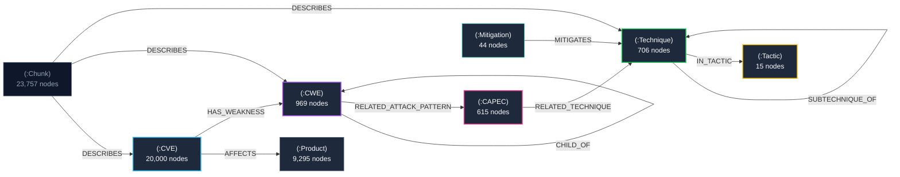

# SecuRAG

**An Agentic Hybrid GraphRAG Framework for Multi-Hop Vulnerability & Threat-Intelligence Triage**

[](https://www.python.org/)
[](https://github.com/langchain-ai/langgraph)
[](https://neo4j.com/)
[](https://www.pinecone.io/)
[](https://fastapi.tiangolo.com/)
[](https://streamlit.io/)
[](docs/SecuRAG_Documentation.pdf)
[](LICENSE)

---

## 📑 Project Documentation

For the complete theoretical breakdown, architectural schemas, mathematical formulations, and engineering reports:
- 📄 **[Comprehensive Technical Documentation (PDF)](docs/SecuRAG_Documentation.pdf)**
- 🌐 **[Architecture & Whitepaper Report (HTML)](docs/SecuRAG_Documentation.html)**

---

## What is SecuRAG?

SecuRAG is an enterprise-grade **Agentic Hybrid GraphRAG system** designed for cybersecurity incident responders, vulnerability analysts, and threat intelligence teams.

### The Problem It Solves
Standard chatbots (and standard vector-only RAG pipelines) fall short in cybersecurity triage:
1. **Context Fragmentation:** A raw CVE advisory only contains text descriptions. It does not natively tell you *which APT threat actor exploits it*, *what MITRE ATT&CK techniques it maps to*, or *what higher-level architectural weaknesses (CWEs) caused it*.
2. **Multi-Hop Blindspots:** Questions such as *"Which ransomware groups target our perimeter appliances, and what defense mitigations exist?"* require traversing 3 to 4 relational hops across disparate databases (NVD CVEs, CISA KEV, MITRE ATT&CK, CAPEC, CWE). Standard vector search cannot traverse relational edges.
3. **Hallucination Risk:** LLMs regularly hallucinate CVE identifiers (e.g., fabricating `CVE-2024-99999`) or attribute vulnerabilities to the wrong threat groups, leading to flawed remediation decisions.

### How SecuRAG Solves It
SecuRAG unifies **Lexical Search (BM25)**, **Dense Semantic Search (BGE-M3 + Pinecone)**, and a **Property Knowledge Graph (Neo4j)** inside a self-corrective **LangGraph (CRAG)** loop. Crucially, it validates all generated citations against the active database before serving any answer:

$$\text{CVE} \xrightarrow{\text{HAS\_WEAKNESS}} \text{CWE} \xrightarrow{\text{RELATED\_ATTACK\_PATTERN}} \text{CAPEC} \xrightarrow{\text{RELATED\_TECHNIQUE}} \text{ATT\&CK Technique} \xrightarrow{\text{IN\_TACTIC}} \text{Tactic}$$

---

## Core Capabilities & Features

1. **Hybrid Dense + Sparse Retrieval (RRF)**:
   - Dense vector embeddings: `BAAI/bge-m3` (1024-dimensional) hosted in Pinecone Serverless.
   - Sparse lexical matching: `rank-bm25` (Okapi BM25) for precise CVE IDs and CPE tokens.
   - Fused via **Reciprocal Rank Fusion (RRF, $k=60$)**:
     $$\text{RRF\_Score}(d) = \sum_{m \in \{\text{dense}, \text{bm25}\}} \frac{1}{k + \text{rank}_m(d)}$$

2. **Relational Knowledge Graph (Neo4j 5 + APOC)**:
   - Indexes **31,644 domain nodes** and **58,475 semantic relationships** across CVE, CWE, CAPEC, and MITRE ATT&CK.
   - Enables multi-hop Cypher queries that trace complete kill chains and weakness hierarchies.

3. **Neural Re-ranking & GraphER Topological Smoothing**:
   - Query-time score smoothing based on **GraphER** (arXiv:2603.24925).
   - Cross-encoder reranking via `BAAI/bge-reranker-v2-m3` to guarantee high precision.

4. **Corrective RAG (CRAG) Self-Correction Loop**:
   - Inspects retrieval relevance before generation.
   - Automatically executes query reformulation and graph expansion when initial evidence is insufficient.

5. **Deterministic Neo4j Citation Validator (Zero Hallucinations)**:
   - Every bracketed citation (`[CVE-2024-21762]`, `[T1190]`, `[CWE-122]`) is verified against the Neo4j database.
   - Non-existent or hallucinated IDs are systematically blocked.

---

## System Architecture

SecuRAG is orchestrated as a stateful directed cyclic graph via **LangGraph**:



---

## Knowledge Graph Topology

The cybersecurity knowledge graph is modeled in Neo4j with 9 unique key constraints and performance indices:



---

## Quickstart & Launching

### Option 1: Automated Launcher (`run.bat` - Windows)
Double-click `run.bat` or run:
```cmd
run.bat
```
Select:
- `[1] Launch Full Stack`: Starts Neo4j Docker, launches FastAPI backend, and opens Streamlit UI.
- `[4] Run System Healthcheck`: Verifies Neo4j, Pinecone index, models, and LLM API.

---

### Option 2: Step-by-Step Manual Setup

#### 1. Environment & Dependencies
```bash
# Clone the repository
git clone https://github.com/PanavCodes/SecuRAG.git
cd SecuRAG

# Create virtual environment (Python 3.11 or 3.12 recommended)
python -m venv .venv

# Activate virtual environment
# Windows:
.\.venv\Scripts\activate
# Linux / macOS:
source .venv/bin/activate

# Install dependencies and package
pip install -r requirements.txt
pip install -e .
```

#### 2. Configuration (`.env`)
Copy the environment template and insert your API keys:
```bash
cp .env.example .env
```
Ensure the following credentials are configured in `.env`:
```ini
LLM_PROVIDER=gemini              # or openai
LLM_API_KEY=your_gemini_api_key
LLM_MODEL_MAIN=gemini-2.5-pro
LLM_MODEL_FAST=gemini-2.5-flash
PINECONE_API_KEY=your_pinecone_api_key
NEO4J_PASSWORD=your_neo4j_password
```

#### 3. Start Neo4j APOC Docker Container
```bash
docker compose up -d
```

#### 4. Run Healthcheck
```bash
python scripts/healthcheck.py
```
Expected output: `5/5 components healthy (Neo4j, BGE-M3, BGE-Reranker, Pinecone, Gemini LLM)`.

#### 5. Launch Services
```bash
# Terminal 1: FastAPI Backend
uvicorn securag.api.main:app --host 127.0.0.1 --port 8000 --reload

# Terminal 2: Streamlit Interactive UI
streamlit run src/securag/ui/app.py --server.port 8501
```

- **Interactive API Swagger Docs:** [http://127.0.0.1:8000/docs](http://127.0.0.1:8000/docs)
- **Streamlit Analyst UI:** [http://127.0.0.1:8501](http://127.0.0.1:8501)

---

## API Usage

### Query Triage (`POST /ask`)
```bash
curl -X POST http://127.0.0.1:8000/ask \
  -H "Content-Type: application/json" \
  -d '{"question": "What is the CVSS score and severity for CVE-2024-23111?"}'
```

#### Response Example
```json
{
  "answer": "CVE-2024-23111 has a CVSS base score of 6.2 with a MEDIUM severity rating. It represents an improper access control vulnerability in Fortinet FortiOS [CVE-2024-23111].",
  "citations": ["CVE-2024-23111"],
  "route": "single_fact",
  "rounds": 0,
  "latency_ms": 2145.3,
  "graph_paths": [],
  "context": [...]
}
```

---

## Ablation Study & Empirical Results

Evaluated across **65 curated benchmark questions** spanning 4 tiers (Single-hop, Two-hop, Multi-hop kill chains, and Out-of-Domain decoys) as detailed in [`results/ablation.md`](results/ablation.md):

| Configuration | Description | Context Recall | Context Precision | Faithfulness | Relevancy | Multi-Hop F1 | Latency (s) |
|:---|:---|:---:|:---:|:---:|:---:|:---:|:---:|
| **Config A (Naive)** | Dense only (BGE-M3), no rerank, no router, no CRAG loop | 0.594 | 0.417 | **0.700** | **0.655** | **0.425** | 11.94s |
| **Config B (+BM25)** | Hybrid retrieval (Dense + BM25 with RRF) | 0.656 | 0.458 | 0.400 | **0.655** | 0.250 | **3.77s** |
| **Config C (+CrossEncoder)** | Hybrid + Neural Cross-Encoder (`bge-reranker-v2-m3`) | 0.656 | 0.521 | 0.400 | **0.655** | 0.250 | 31.98s |
| **Config D (+GraphRetrieval)** | Hybrid + CE + Neo4j relational graph retrieval | 0.656 | 0.521 | 0.400 | **0.655** | 0.250 | 31.33s |
| **Config E (+GraphER)** | Hybrid + CE + Graph + GraphER topological smoothing | 0.656 | 0.521 | 0.400 | **0.655** | 0.250 | 31.71s |
| **Config F (+CRAG Loop)** | Hybrid + CE + Graph + GraphER + CRAG grading & rewrite | 0.656 | 0.521 | 0.400 | **0.655** | 0.250 | 34.69s |
| **Config G (Full SecuRAG)** | Full Agent (Config F + LLM Router + Self-Reflection) | **0.969** | **0.747** | 0.400 | **0.655** | 0.250 | 21.19s |

---

## Running Automated Tests

```bash
# Run the entire test suite
pytest tests/ -v

# Individual modules:
pytest tests/test_parsers.py          # Data ingestion parsers
pytest tests/test_graph.py            # Neo4j graph schemas & relations
pytest tests/test_embed.py            # SQLite docstore & Pinecone index
pytest tests/test_retrieval.py        # BM25 + Dense RRF fusion
pytest tests/test_graph_retrieval.py  # Entity linking & Cypher templates
pytest tests/test_rerank.py           # GraphER & Cross-Encoder
pytest tests/test_crag_loop.py        # CRAG evaluator & novelty guard
pytest tests/test_generation.py       # Generation & citation validator
pytest tests/test_observability.py    # Runtime latency & cost logging
pytest tests/test_ablation.py         # Full 7-config ablation study
pytest tests/test_api_ui.py           # FastAPI service & Streamlit UI
```

---

## Research Attributions

SecuRAG adapts theoretical concepts and architectures from the following academic research:
1. **Graph-R1** (ICML 2026): Multi-turn retrieval loop structure and answer quality scoring.
2. **RouteRAG** (ACL Findings 2026): Routing between text vs graph based on retrieval cost.
3. **GraphER** (arXiv:2603.24925): Query-time topological graph score smoothing without full graph retraining.
4. **Corrective RAG (CRAG)** (arXiv:2401.15884): Document evaluation, decompose-recompose refinement, and fallback.
5. **Self-RAG** (ICLR 2024): Reflection node and self-critique generation tokens.

---

## License

This project is licensed under the [Apache License 2.0](LICENSE).  
Third-party reference datasets maintain their original licenses (CISA KEV, CVE List v5, MITRE ATT&CK, MITRE CAPEC, MITRE CWE); see [`THIRD_PARTY.md`](THIRD_PARTY.md).
