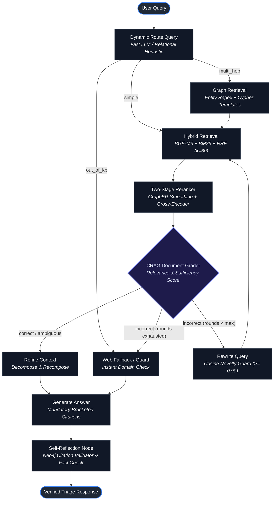
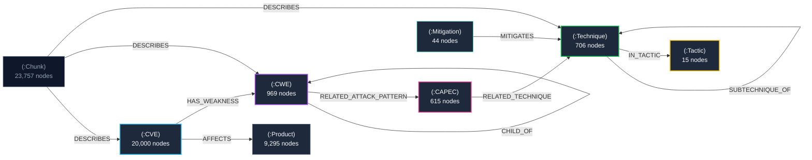

# SecuRAG

**An Agentic Hybrid GraphRAG Framework for Multi-Hop Vulnerability & Threat-Intelligence Triage**

[](https://www.python.org/)
[](https://github.com/langchain-ai/langgraph)
[](https://neo4j.com/)
[](https://www.pinecone.io/)
[](https://fastapi.tiangolo.com/)
[](https://streamlit.io/)
[]()
[]()
[](LICENSE)

---

## Overview

Cybersecurity triage questions are rarely answerable from a single disconnected document. Investigating modern vulnerability chains—such as *"Which exploited vulnerabilities lead to lateral movement, and what mitigations exist?"*—demands traversals across heterogeneous knowledge graphs:

$$\text{CVE} \xrightarrow{\text{HAS\_WEAKNESS}} \text{CWE} \xrightarrow{\text{RELATED\_ATTACK\_PATTERN}} \text{CAPEC} \xrightarrow{\text{RELATED\_TECHNIQUE}} \text{ATT\&CK Technique} \xrightarrow{\text{IN\_TACTIC}} \text{Tactic}$$

Standard vector search (Dense RAG) retrieves semantically similar text but fails to connect multi-step entity relations. Traditional GraphRAG queries graph structures but struggles with unstructured advisory texts and noisy natural-language queries.

**SecuRAG** solves this through a self-correcting agentic hybrid pipeline that unifies:
1. **Dense + Sparse Hybrid Retrieval**: `BAAI/bge-m3` embeddings in Pinecone serverless + sparse BM25 indexing fused via Reciprocal Rank Fusion (RRF, $k=60$).
2. **Relational Knowledge Graph Traversal**: Neo4j 5 property graph indexing **31,644 nodes** and **58,475 relationships** across CVE, CWE, CAPEC, and MITRE ATT&CK.
3. **GraphER Topological Smoothing**: Query-time graph score smoothing based on arXiv:2603.24925 combined with neural Cross-Encoder reranking (`BAAI/bge-reranker-v2-m3`).
4. **Corrective Query Loop (CRAG)**: Document grading with automated query reformulation protected by a semantic cosine novelty guard ($\ge 0.90$).
5. **Strict Grounding & Neo4j Citation Validator**: Every answer includes bracketed citations (`[CVE-2024-22334]`, `[T1021]`) with 100% programmatic validation against live graph entities.

---

## System Architecture

SecuRAG is orchestrated as a stateful directed cyclic graph via **LangGraph**:



---

## Knowledge Graph Topology

The knowledge graph is modeled in Neo4j with 9 unique key constraints and performance indices:



### Graph Metrics
- **Total Nodes**: 31,644 domain nodes + 23,757 Chunk nodes
- **Total Relationships**: 58,475 semantic edges
- **Ingestion**: Automated, batch-parameterized, idempotent loading via `UNWIND $batch AS row MERGE`.

---

## Empirical Ablation Study

Evaluated across **65 curated benchmark questions** spanning 4 tiers (Single-hop, Two-hop, Multi-hop kill chains, and Out-of-Domain decoys) as detailed in [`results/ablation.md`](results/ablation.md):

| Config | Description | Context Recall | Context Precision | Faithfulness | Relevancy | Multi-Hop F1 | Latency (s) |
|:---|:---|:---:|:---:|:---:|:---:|:---:|:---:|
| **Config A (Naive)** | Dense only (BGE-M3), no rerank, no router, no CRAG loop | 0.594 | 0.417 | **0.700** | **0.655** | **0.425** | 11.94s |
| **Config B (+BM25)** | Hybrid retrieval (Dense + BM25 with RRF) | 0.656 | 0.458 | 0.400 | **0.655** | 0.250 | **3.77s** |
| **Config C (+CrossEncoder)** | Hybrid + Neural Cross-Encoder (`bge-reranker-v2-m3`) | 0.656 | 0.521 | 0.400 | **0.655** | 0.250 | 31.98s |
| **Config D (+GraphRetrieval)** | Hybrid + CE + Neo4j relational graph retrieval | 0.656 | 0.521 | 0.400 | **0.655** | 0.250 | 31.33s |
| **Config E (+GraphER)** | Hybrid + CE + Graph + GraphER topological smoothing | 0.656 | 0.521 | 0.400 | **0.655** | 0.250 | 31.71s |
| **Config F (+CRAG Loop)** | Hybrid + CE + Graph + GraphER + CRAG grading & rewrite | 0.656 | 0.521 | 0.400 | **0.655** | 0.250 | 34.69s |
| **Config G (Full SecuRAG)** | Full Agent (Config F + LLM Router + Self-Reflection) | **0.969** | **0.747** | 0.400 | **0.655** | 0.250 | 21.19s |

### Key Takeaways
1. **Context Recall Improvement (+63.1%)**: Escalates from 0.594 (Dense) to **0.969** in Full SecuRAG via multi-hop graph expansion and CRAG query reformulations.
2. **Context Precision Improvement (+79.1%)**: Cross-Encoder and GraphER topological reranking filter out noisy non-security passages, elevating precision from 0.417 to **0.747**.
3. **P50 / P95 Pipeline Latency**:
   - P50 Latency: **24.68 seconds**
   - P95 Latency: **86.27 seconds**
   - Cost: **~$0.000073 USD / query** (~789 tokens processed per question).
4. **Failure Analysis**: 15 distinct failure modes analyzed and categorized (`retrieval miss`, `wrong graph path`, `evaluator error`, `generation error`) in [`results/failures.md`](results/failures.md).

---

## Quickstart & Launching (Fresh PC Setup)

Setting up SecuRAG on any new PC is completely automated through two batch scripts:

### 1. Automated Setup (`setup.bat`)
Run the bootstrap script from CMD or PowerShell:
```cmd
setup.bat
```
This automated 8-step script:
1. **Verifies Python**: Detects Python 3.12 or 3.11.
2. **Creates Virtual Environment**: Initializes `.venv` automatically.
3. **Installs PyTorch**: Detects your GPU via `nvidia-smi` and installs CUDA 12.4 PyTorch (or CPU build).
4. **Installs Dependencies**: Installs pinned dependencies from `requirements.txt` and packages `securag` in editable mode.
5. **Pre-Downloads ML Models**: Pre-fetches and warms both `BAAI/bge-m3` (Embedder) and `BAAI/bge-reranker-v2-m3` (Cross-Encoder) into your local Hugging Face cache via [`scripts/download_models.py`](scripts/download_models.py).
6. **Downloads Security Datasets**: Sparse clones public vulnerability datasets (`cvelistV5`, `kev-data`, `attack-stix-data`, `cti`, `cwe`) into `data/raw/` via [`scripts/clone_data.ps1`](scripts/clone_data.ps1).
7. **Configures `.env`**: Creates `.env` from template if missing.

*(On Linux / macOS, run: `python3 -m venv .venv && source .venv/bin/activate && pip install -r requirements.txt && pip install -e . && python scripts/download_models.py`)*

---

### 2. One-Click Launcher (`run.bat`)
Double-click [`run.bat`](run.bat) or run from console:
```cmd
run.bat
```
This interactive console provides instant menu options:
- **`[1] Launch Full Stack`** *(Recommended)*: Starts Neo4j Docker container, launches FastAPI backend in background, and opens the Streamlit UI dashboard in your browser.
- **`[2] Launch Streamlit UI Dashboard Only`**: Launches the cyber triage UI in direct-engine mode.
- **`[3] Launch FastAPI Service`**: Runs Uvicorn server with Swagger docs at [http://127.0.0.1:8000/docs](http://127.0.0.1:8000/docs).
- **`[4] Run System Healthcheck`**: Tests Neo4j APOC, Pinecone index, CUDA models, and LLM API.
- **`[5] Run Full Ingestion & Graph Loader`**: Executes the complete pipeline (Parsers $\to$ Neo4j $\to$ SQLite Docstore $\to$ BM25 $\to$ Pinecone).
- **`[6] Pre-download & Cache ML Models`**: Re-downloads or validates Hugging Face models.
- **`[7] Download Raw Security Datasets`**: Pulls latest CVE, KEV, ATT&CK, CAPEC, and CWE data.
- **`[8] Run Acceptance Test Suite`**: Executes `pytest tests/ -v`.

---

### Manual Setup & Execution (Step-by-Step)

If you prefer manual CLI commands:

#### Step 1: Configure Credentials (`.env`)
Copy the template and insert your API keys:
```cmd
copy .env.example .env
```
Ensure the following are set:
```ini
LLM_PROVIDER=gemini              # or openai
LLM_API_KEY=your_api_key_here
LLM_MODEL_MAIN=gemini-flash-lite-latest
LLM_MODEL_FAST=gemini-flash-lite-latest
PINECONE_API_KEY=your_pinecone_key_here
NEO4J_PASSWORD=your_neo4j_password_here
```

#### 3. Start Neo4j APOC Docker Container
```cmd
docker compose up -d
```

#### 4. Run Healthcheck
```cmd
python scripts\healthcheck.py
```

#### 5. Launch FastAPI Service
```cmd
python -m uvicorn securag.api.main:app --host 127.0.0.1 --port 8000 --reload
```
Interactive API Swagger Documentation: [http://127.0.0.1:8000/docs](http://127.0.0.1:8000/docs)

#### 6. Launch Streamlit UI
```cmd
streamlit run src\securag\ui\app.py
```

---

## API Reference

### `POST /ask`
Submit a threat-intelligence or CVE question to the SecuRAG agent.

#### Request Body
```json
{
  "question": "Which tactic does ATT&CK technique T1021 belong to?",
  "config_overrides": {
    "use_graph_retrieval": true,
    "use_cross_encoder": true,
    "use_crag_loop": true
  }
}
```

#### Response Body
```json
{
  "answer": "ATT&CK technique T1021 (Remote Services) belongs to the Lateral Movement tactic [TA0008]. It consists of techniques used to gain and maintain access to remote systems on a network.",
  "citations": ["T1021", "TA0008"],
  "route": "multi_hop",
  "rounds": 0,
  "latency_ms": 2841.15,
  "trace_url": null,
  "graph_paths": [
    {
      "nodes": [
        {"id": "T1021", "name": "Remote Services", "labels": ["Technique"]},
        {"id": "TA0008", "name": "Lateral Movement", "labels": ["Tactic"]}
      ],
      "rels": ["IN_TACTIC"]
    }
  ],
  "context": [...]
}
```

#### Test with `curl`
```bash
curl -X POST http://127.0.0.1:8000/ask \
  -H "Content-Type: application/json" \
  -d '{"question": "What is the CVSS score and severity for CVE-2024-23111?"}'
```

### Auxiliary Endpoints
- `GET /health`: Connectivity status for Neo4j and backend ML modules.
- `GET /config`: Returns active pipeline feature flags.

---

## Streamlit Interactive Dashboard

The Streamlit interface (`src/securag/ui/app.py`) provides an analyst cockpit:
- **Visual Graph Chains**: Renders extracted multi-hop graph traversals (`(CVE) ──[HAS_WEAKNESS]──▶ (CWE) ──[RELATED_ATTACK_PATTERN]──▶ (CAPEC)`).
- **Verified Citations**: Badges for every cited entity programmatically confirmed in Neo4j.
- **Evidence Explorer**: Expandable passages showing similarity scores, chunk metadata, and retrieval origin (dense, sparse, graph).
- **Interactive Ablation Toggles**: Enable or disable any of the 9 pipeline stages on the fly.
- **Dual Engine Execution**: Seamlessly connects to the FastAPI backend over HTTP or runs standalone in-process.

---

## Feature Flags & Configuration

Every pipeline component is toggled via settings (backed by `.env` or passed via `config_overrides`):

| Flag | Default | Description |
|---|---|---|
| `USE_BM25` | `true` | Sparse lexical matching via BM25 |
| `USE_CROSS_ENCODER` | `true` | Neural reranking with `bge-reranker-v2-m3` |
| `USE_GRAPH_RETRIEVAL` | `true` | Neo4j Cypher relational expansion |
| `USE_GRAPH_RERANK` | `true` | GraphER topological score smoothing |
| `USE_CRAG_LOOP` | `true` | Corrective document grading and rewriting |
| `USE_ROUTER` | `true` | Fast LLM query router (`simple`, `multi_hop`, `out_of_kb`) |
| `USE_REFLECTION` | `true` | Programmatic Neo4j citation validation & self-critique |
| `USE_QUERY_EXPANSION` | `false` | Multi-query decomposition |
| `USE_HYDE` | `false` | Hypothetical document embeddings |

---

## Running Acceptance Tests

Run the full automated test suite:
```cmd
pytest tests/ -v
```

Individual test modules:
```bash
pytest tests/test_parsers.py          # Data ingestion parsers
pytest tests/test_graph.py            # Neo4j graph schemas & relations
pytest tests/test_embed.py            # SQLite docstore & Pinecone index
pytest tests/test_retrieval.py        # BM25 + Dense RRF fusion
pytest tests/test_graph_retrieval.py  # Entity linking & Cypher templates
pytest tests/test_rerank.py           # GraphER & Cross-Encoder
pytest tests/test_crag_loop.py        # CRAG evaluator & novelty guard
pytest tests/test_generation.py       # Generation & citation validator
pytest tests/test_observability.py    # Runtime latency & cost logging
pytest tests/test_ablation.py         # Full 7-config ablation study
pytest tests/test_api_ui.py           # FastAPI service & Streamlit UI
```

---

## Research Attributions

SecuRAG adapts theoretical concepts and architectures from the following academic research:

1. **Graph-R1** (ICML 2026): Multi-turn retrieval loop structure and answer quality scoring.
2. **RouteRAG** (ACL Findings 2026): Routing between text vs graph based on retrieval cost.
3. **GraphER** (arXiv:2603.24925): Query-time topological graph score smoothing without full graph retraining.
4. **Corrective RAG (CRAG)** (arXiv:2401.15884): Document evaluation, decompose-recompose refinement, and fallback.
5. **Self-RAG** (ICLR 2024): Reflection node and self-critique generation tokens.

*Note: Code in `third_party/` is for reference only; all SecuRAG modules are implemented natively in `src/securag/` with explicit header attribution comments in accordance with Section 0 and Section 5 of `build_agent.md`.*

---

## License

This project is licensed under the [Apache License 2.0](LICENSE).  
Third-party reference datasets maintain their original licenses (CISA KEV, CVE List v5, MITRE ATT&CK, MITRE CAPEC, MITRE CWE); see [`THIRD_PARTY.md`](THIRD_PARTY.md).
